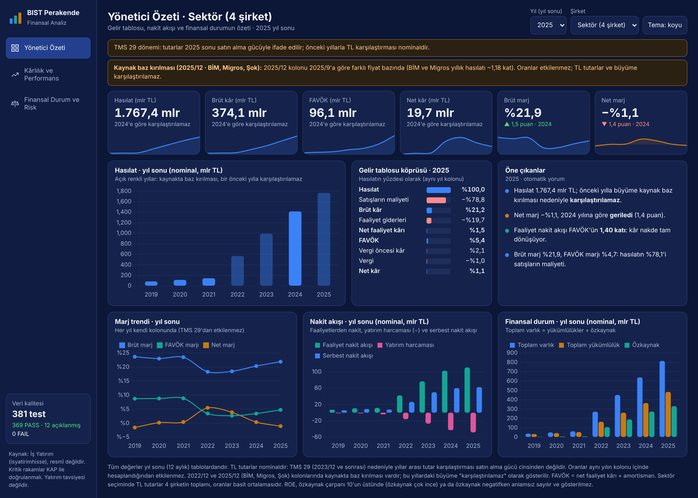
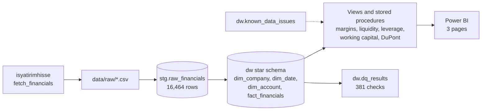

# RetailFinance: BIST Retail Financial Performance Analytics (SQL Server & Power BI)

End-to-end financial data project on four Borsa Istanbul retailers: **BİM (BIMAS), Migros (MGROS), Şok (SOKM) and CarrefourSA (CRFSA)**, seven years of quarterly statements (2019/3 to 2025/12, 28 periods).

### Canlı pano
[📊 BIST Perakende Finansal Analiz sayfasını aç](https://emre-cakir0.github.io/bist-retail-finance/RetailFinance_Dashboard.html)

Raw statements are pulled with Python, loaded into SQL Server, standardised into a star schema, turned into ratio views and stored procedures, validated by an automated data-quality suite (381 checks, 0 unexplained failures) and presented in a three-page Power BI report.



<sub>HTML version of the dashboard ([docs/RetailFinance_Dashboard.html](docs/RetailFinance_Dashboard.html)): open it in a browser, no server needed. More views: [profitability](docs/img/dashboard_profitability.png) · [balance sheet and risk](docs/img/dashboard_balance_risk.png).</sub>

The part I care most about is not the tooling but the data problems it surfaced: statements reported **cumulatively (year-to-date)** and the **TMS 29 inflation-accounting switch**, which changes what you can and cannot compare across periods. See [Known data issues](#known-data-issues-and-how-they-are-handled).

## Pipeline



Entity-relationship diagram: [docs/ER_diagram.md](docs/ER_diagram.md).

## Scope

| Item | Value |
|---|---|
| Companies | BIMAS, MGROS, SOKM, CRFSA (non-financial retail; banks use a different statement format and are out of scope) |
| Periods | 2019/3 to 2025/12, quarterly (28 periods) |
| Source | İş Yatırım via the `isyatirimhisse` Python library (unofficial, personal use). KAP is the official source for verification |
| Volume | 147 line items x 28 periods x 4 companies = 16,464 staging rows; 16,448 fact rows (16 empty source cells) |
| Standard line items | 36 keys (Revenue, COGS, TotalAssets, ...) mapped from the 147 source codes |

## Key design decisions

1. **Long-format fact table, values stored as reported.** Income-statement and cash-flow items arrive year-to-date. They are stored as reported; quarterly values are derived in a view (`dw.vw_fact_quarterly`).
2. **Ratios are computed inside a single period column.** Numerator and denominator then share the same price basis, which matters under TMS 29. Flow items are annualised (`YTD x 12 / months`); balance-sheet items use period-end balances (no averages across periods).
3. **EBITDA = net operating profit (`3H`) + depreciation & amortisation.** `3H` is gross profit less selling and administrative expenses. The broader operating profit (`3DF`) includes "other operating income/expense", which swings with FX and monetary effects in the TMS 29 era (Migros 2025: `3DF` is -9.7 bn TL while `3H` is +13.2 bn TL).
4. **Meaningless ratios are blank, not extreme.** Net debt/EBITDA, OCF/EBITDA and EBITDA/finance expense are NULL when EBITDA margin is below 1%; ROE is NULL when equity is not positive.
5. **The finance line is a signed net amount.** Source line `3HC` is net finance income/expense: pre-tax profit = EBIT (`3HACA`) + `3HB` + `3HC` holds exactly in every period. It turns positive (net income) under TMS 29 monetary gains, so interest coverage is computed only when the line is a net expense and is NULL otherwise.
6. **Every claim about the source data is tested or recorded.** Tests live in `dw.dq_results`; exceptions live in `dw.known_data_issues` with evidence.

## Data quality

`EXEC dw.usp_run_quality_checks` writes one row per check (test, company, period, result, detail).

| Test | What it checks | Checks | Pass | Explained | Fail |
|---|---|---:|---:|---:|---:|
| `BS_BALANCE` | Total assets = total liabilities and equity (also asset and liability breakdowns), tolerance 1,000 TL | 112 | 112 | 0 | 0 |
| `IDENTITIES` | Gross profit = revenue + COGS; total equity = parent + minority | 112 | 112 | 0 | 0 |
| `QUARTER_SUM` | Four derived quarters sum to the annual value, no missing quarter | 28 | 28 | 0 | 0 |
| `QUARTER_PLAUSIBILITY` | Derived quarterly revenue is positive and within 0.5x to 2.0x of the previous quarter | 112 | 102 | 10 | 0 |
| `MISSING_PERIODS` | All 28 expected periods exist for each company | 4 | 4 | 0 | 0 |
| `DUPLICATES_STG` / `DUPLICATES_FACT` | One row per company, period and line item | 5 | 5 | 0 | 0 |
| `MAPPING_COVERAGE` | Every standard key is populated in all 28 periods for all 4 companies | 4 | 4 | 0 | 0 |
| `TMS29_FLAG` | TMS 29 start date and source recorded; flagged periods match expectation | 4 | 2 | 2 | 0 |
| **Total** | | **381** | **369** | **12** | **0** |

*Explained* means the check did not pass but the exception is documented with evidence in `dw.known_data_issues`. There are no unexplained failures.

Ratio views were also cross-checked against independent hand calculations from the raw CSVs (three examples, 12 values, equal to 9 decimals). That check found and fixed a real bug: `12.0 / 9` is a DECIMAL division in SQL Server and truncated the annualisation factor for 9-month periods.

## Known data issues and how they are handled

**1. Cumulative reporting.** Income statement and cash flow are year-to-date. Quarterly figures are derived by differencing.

**2. TMS 29 (inflation accounting).** Applied from the annual statements ending 31.12.2023 (SPK decision 28.12.2023, no. 81/1820). From then on each period column is expressed in that period's end purchasing power. Consequences:
- Naive year-to-date differencing overstates later-quarter flows. Example: BİM Q3 2024 derives to 190.3 bn TL from the dataset, while the officially reported quarterly revenue is 167.9 bn TL.
- Period-over-period growth in this era is **nominal**, not real.
- Ratios inside one column (margins, liquidity, leverage, DuPont) are unaffected, which is why the analysis layer is built on them.

**3. Basis breaks in the source data.** Cross-checking against published figures showed that some period columns sit on a different price basis than their neighbours:
- **2022/12** carries restated comparatives (total assets jump about 2.6x versus 2022/9; derived Q4 2022 revenue is about 4x). Same pattern in all four companies.
- **2025/12** (BİM, Migros, Şok): BİM's published FY2025 revenue is about 721 bn TL versus 849 bn TL in the dataset; Migros about 413 bn versus 486 bn (a factor of about 1.18 in both). BİM's published 9M 2025 revenue (512,767 mn TL) matches the dataset's 2025/9 exactly, so the 2025/9 column itself is sound, but derived Q3 and Q4 2025 are not.
- These are recorded in `dw.known_data_issues`; the growth view labels every comparison `NOMINAL`, `NOMINAL_TMS29` or `BASE_BREAK`, and the Power BI measures carry the same flag.

**Source verification status.** TMS 29 start date is confirmed from primary documents for BİM (auditor's report) and CarrefourSA (interim report). For Migros and Şok only secondary sources were found (news and a broker report); those two checks are marked `EXPLAINED` until confirmed against the KAP filing.

## Key findings (period 2025/12, ratios computed within the column)

| | Gross margin | EBITDA margin | Net margin | OCF / EBITDA | Net debt / EBITDA | Current ratio | ROE (annualised) |
|---|---:|---:|---:|---:|---:|---:|---:|
| BİM | 19.3% | 6.0% | 2.6% | 0.94 | 0.89x | 1.03 | 11.2% |
| Migros | 24.3% | 6.6% | 1.7% | 1.05 | 0.14x | 0.79 | 8.5% |
| Şok | 20.5% | 2.8% | -0.7% | 2.87 | 0.66x | 0.86 | -5.4% |
| CarrefourSA | 23.4% | 3.5% | -7.8% | 0.74 | 5.46x | 0.48 | n.m. (negative equity) |

Short reading: BİM turns the thinnest gross margin into the best net margin and ROE; Migros combines the best EBITDA margin with the lowest leverage; CarrefourSA has the weakest balance sheet. Details and caveats: [docs/analyst_note.md](docs/analyst_note.md) (Turkish).

## Repository layout

| Path | Purpose |
|---|---|
| `01_create_schema.sql` | Database, `stg` and `dw` schemas, dimension and fact tables, company and date seed |
| `02_extract_raw.py` | Pulls statements per company into `data/raw/*.csv` |
| `02b_inspect_raw.py` | Profiles the CSVs (columns, periods, line-item overlap across companies) |
| `03_create_staging.sql`, `03_load_staging.py` | Staging table; wide-to-long load with row-count reconciliation against the CSVs |
| `04_standardize.sql` | `dim_account`, standard-key mapping, TMS 29 flags, load procedure, quarterly view, known-issues register |
| `05_analytics.sql` | Ratio, growth and quarterly views; sector and DuPont stored procedures |
| `06_quality_checks.sql` | Data-quality tests and result table |
| `run_sql.py`, `run_pipeline.py` | Run a .sql file / run the whole SQL pipeline from scratch |
| `powerbi/RetailFinance_SektorOzeti.pbip` | Power BI project (TMDL semantic model + PBIR report), final version |
| `powerbi/build_pbip.py` | Script that generated the first version of the model and pages as code (82 measures) |
| `powerbi/measures.dax`, `powerbi/dashboard_spec.md` | First draft of the measures and the page specification |
| `docs/` | ER diagram, analyst note (Turkish), HTML dashboard, screenshots |

## How to run

Requirements: SQL Server (Express is enough) with ODBC Driver 18, Python 3.11. Scripts connect to `localhost\SQLEXPRESS` with Windows authentication (change `SERVER` in `run_sql.py` and `03_load_staging.py` if yours differs).

```powershell
pip install -r requirements.txt
python 02_extract_raw.py     # needs network; writes data/raw/*.csv
python run_pipeline.py       # runs steps 01, 03, 04, 05, 06 from scratch
```

Raw CSVs are not committed: they come from an unofficial source intended for personal use.

## Power BI

The report is a Power BI Project (PBIP: TMDL model + PBIR report), so the model (8 tables, 6 relationships, 82 DAX measures) and the three pages are reviewable text under version control. The first version was generated by `powerbi/build_pbip.py`; the committed report is the final, hand-refined version.

Open `powerbi/RetailFinance_SektorOzeti.pbip` in Power BI Desktop and click **Refresh** (import from the `dw` views on `localhost\SQLEXPRESS`). Pages:
- **Sektör Özeti:** margins and ranks for the selected period, EBITDA-margin trend, revenue share, company table with nominal growth and its comparability flag.
- **Şirket Detayı:** margin trends, DuPont decomposition, working-capital days, cash conversion.
- **Likidite ve Borçluluk:** current/quick/cash ratios, net debt/EBITDA, leverage versus ROE.

Every page carries the data-quality summary and the source and TMS 29 footnotes. KPI cards compare with the same period of the previous year.

## Limitations and next steps

- **Growth is nominal.** Real growth needs a CPI series (TCMB EVDS) to restate columns to a common price basis. This is the highest-value extension.
- **Source reliability.** The dataset is not an official filing. Critical figures should be validated against KAP; the known basis breaks above show why.
- **Annualised year-to-date.** Ratios that annualise partial-year flows ignore seasonality.
- **Debt definition.** Financial debt is taken as reported in the source; it may include lease liabilities.
- Optional extensions: share prices and valuation multiples, USD/TRY, an `add_company.py` for one-command onboarding of more retailers.

## Follow-up project

The same data model and rules were later extended into **BIST Finansal Analiz**, a financial-statement analysis app for any non-financial BIST company (separate repository: [bist-finansal-analiz](https://github.com/emre-cakir0/bist-finansal-analiz)).
