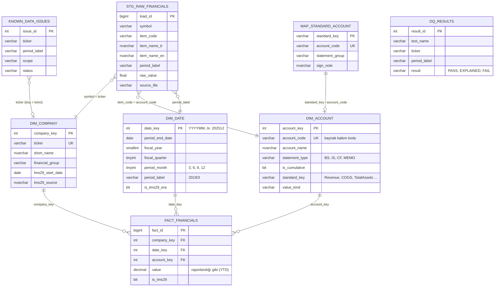

# RetailFinance - Veri modeli (ER diyagramı)

GitHub ve VS Code (Markdown Preview Mermaid Support eklentisi) bu diyagramı doğrudan çizer.

## Katmanlar

| Katman | Nesneler | Not |
|---|---|---|
| Staging (`stg`) | `raw_financials` | CSV'nin uzun formata çevrilmiş, değiştirilmemiş hali |
| Veri ambarı (`dw`) | `dim_company`, `dim_date`, `dim_account`, `fact_financials` | Yıldız şema; değerler raporlandığı gibi (kümülatif) saklanır |
| Eşleştirme | `map_standard_account` | 147 kaynak kalemden 36 standart anahtar |
| Analiz | `vw_std_ytd`, `vw_ratios`, `vw_fact_quarterly`, `vw_quarterly_std`, `vw_growth_ytd` | Oranlar aynı dönem kolonu içinde hesaplanır |
| Prosedürler | `usp_load_financials`, `usp_company_ratios`, `usp_sector_snapshot`, `usp_dupont`, `usp_run_quality_checks` | |
| Kalite | `dq_results`, `vw_dq_summary`, `known_data_issues` | Test sonuçları ve belgelenmiş istisnalar |
